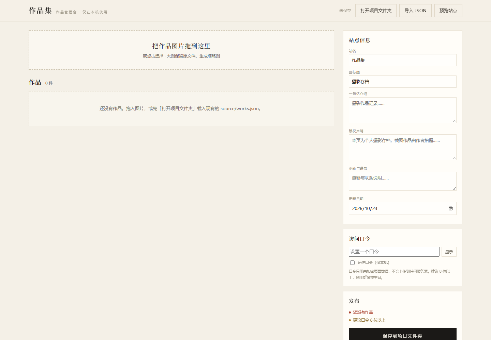

# 从零部署指南

> 给完全没做过网页的人看的。照着点就行，不需要服务器、不需要域名、不需要付款。

**你需要：** 一台 Windows 电脑、Edge 或 Chrome 浏览器、一个能收邮件的邮箱。

**总流程：**

```
下载模板 → 解压 → 管理台加图 → 注册 Cloudflare → 上传 site → 测试分享
```

---

## 第 1 步：下载模板

在 GitHub 仓库页面：

- 点绿色的 **Code** → **Download ZIP**（公开仓库，不用登录）；
- 或者点 **Use this template** 创建自己的仓库（需要 GitHub 账号，可选）。

> 不要直接在压缩包里双击运行，必须先解压。

## 第 2 步：解压

右键压缩包 → **全部解压**。

解压后应该看到：

```
作品集模板/
├─ site/                 ← 待会要上传这个
├─ admin.html
├─ source/
├─ 打开管理台.bat
├─ 打开作品页.bat
└─ README.md
```

> Mac 用户：没有 `.bat`，直接双击 `admin.html`，用 Chrome 打开。

## 第 3 步：用管理台加自己的图

1. 双击 **`打开管理台.bat`**；
2. 如果 Windows 提示“已保护你的电脑”，点 **更多信息 → 仍要运行**；
3. 点右上角 **打开项目文件夹**，选择解压出来的文件夹（里面有 `site` 和 `source`）；
4. 把图片拖进虚线框；
5. 在每行填：作者、标题、标签（逗号分隔）、说明；
6. 在右侧 **访问口令** 里设一个自己的口令；
7. 点 **保存到项目文件夹**，看到顶部变成「已保存」。



> 保存只是写到你的电脑上，**还没有上线**。下一步才上传。

**注意：** 一定要先「打开项目文件夹」，否则管理台是空的，保存会把已有作品覆盖掉。

## 第 4 步：注册 Cloudflare

1. 打开 <https://dash.cloudflare.com>；
2. 点 **Sign up**，填邮箱和密码；
3. 去邮箱点验证链接（找不到就看垃圾箱）；
4. 免费计划就够，**不用绑卡、不用买域名**。

已经有账号的直接登录，跳到下一步。

## 第 5 步：上传到 Cloudflare Pages

1. 左侧 **Compute** → **Workers & Pages**；
2. 右上角 **Create application**；
3. 选 **Pages** → **Drag and drop your files**；
4. 项目名填一个英文名，比如 `my-gallery`（会变成网址的一部分）；
5. 把 **`site` 文件夹**拖进去（不是整个项目根目录）；
6. 点 **Deploy site**，等 1 分钟；
7. 得到一个网址：`https://my-gallery.pages.dev`。

> ⚠️ 不要用首页的「Drop a folder, or a zip」——那会创建 Worker，`workers.dev` 国内打不开。
>
> ⚠️ 如果你已经有 Worker 项目，不要在它的页面点 **New deployment**；要新建一个 **Pages** 项目。

### 打开是 404 怎么办

说明多套了一层目录。重新部署，改成拖 **`site` 里面的内容**（全选 `index.html`、`assets`、`data`、`media` 等一起拖），保证 `index.html` 在最外层。

## 第 6 步：测试和分享

1. 电脑打开 `https://你的项目名.pages.dev`；
2. 输入你设的口令；
3. 看到自己的图片就成功了；
4. 用**手机流量、家里 Wi-Fi、微信内置浏览器**各开一次，确认速度；
5. 把链接和口令发给要看的人。

---

## 以后怎么更新

1. 双击 `打开管理台.bat`；
2. 打开项目文件夹，加图/改标签；
3. 保存；
4. Cloudflare → 你的 Pages 项目 → **Create new deployment**；
5. 重新拖 `site` 文件夹 → Deploy。

**只上传 `site/`。** `admin.html` 和 `source/` 留在本机。

---

## 常见问题

**点「进入」没反应？**
看输入框下方有没有红字：
- 「请先输入口令」→ 没输入；
- 「口令不对」→ 检查空格/全半角；
- 「页面数据没有加载成功」→ `index.html` 和 `data/works.enc.js` 没在一起，重新上传 `site`。

**中文口令打不出来？**
点口令框右侧的「显示」，切换成普通文本框再输入。

**图片不显示？**
确认 `site/media/` 里有图片，且上传的是整个 `site`。

**忘记口令了？**
无法找回。用管理台重新设一个，保存后重新部署。

**示例作品怎么还在？**
上传第一张图后会从列表移除；保存时再清理示例文件。如果还没保存，示例文件不会被提前删掉。

**微信提示“非官方网页”？**
点继续访问，正常现象。

**免费额度够吗？**
Cloudflare Pages 免费：2 万个文件、单文件 25MB、流量不额外收费。个人用基本够。

---

## 安全说明

- 口令是用来加密数据的，**不是真正的权限控制**；
- 图片文件本身没有加密，知道具体图片地址的人仍能直接打开；
- 不要把口令当银行密码复用；
- 特别敏感的内容不要放上来。

---

## 一页清单

- [ ] 下载并解压
- [ ] 管理台打开项目文件夹
- [ ] 加图、填作者/标签
- [ ] 设置口令并保存
- [ ] 注册 Cloudflare
- [ ] 创建 Pages，上传 `site`
- [ ] 手机/微信测试
- [ ] 分享链接 + 口令
